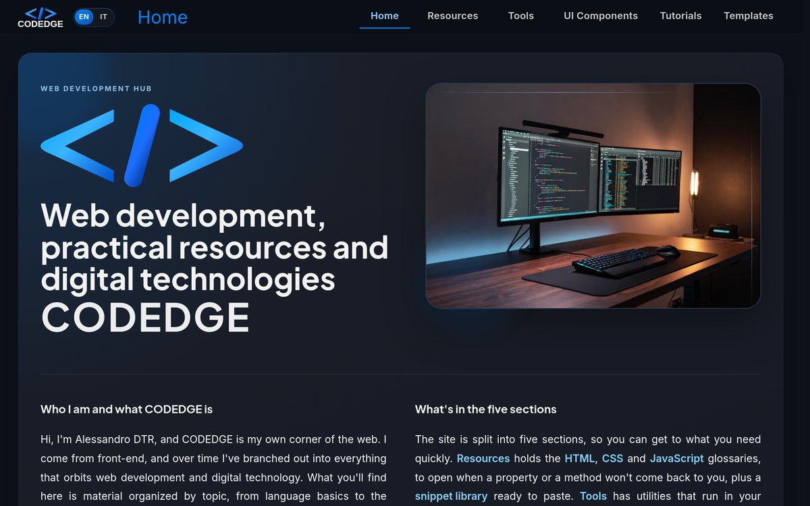

# CODEDGE

[](https://github.com/aledtr77/codedge/actions/workflows/deploy.yml)
[-3fb950)](tests/)
[](LICENSE)

Source of **[codedge.it](https://codedge.it)** — a bilingual front-end learning
reference that I curate while developing my web skills. It is assembled as a
multi-page Vite site with semantic HTML, modular CSS and JavaScript.

[](https://codedge.it)

## Project role and AI use

This is an AI-assisted personal project, not professional reference material. I set
the scope, organise the learning experience, choose what to publish and define the
checks a change must pass. AI supports much of the implementation, translation and
documentation; I review the output, run the verification workflow and maintain the
published result.

The glossary and tutorials are curated learning content. Readers should verify
important technical details against standards and official documentation, and
corrections are welcome through the repository issue tracker.

## What's on it

- **Glossaries** — 418 entries across HTML, CSS and JavaScript, to open when a property
  or a method won't come back to you
- **Tutorials** — 13 practical guides: Git and GitHub, browser DevTools, accessibility,
  deployment, technical SEO, developing with AI, and the fundamentals of the three
  languages, and digital marketing for indie developers
- **Tools** — four utilities that run entirely in the browser: colour and gradient
  generators, an image compressor, a palette extractor
- **UI components** — four components with the full commented source, plus a snippet
  library ready to paste
- **Templates** — live demos of the portfolio projects

## How it's built

Plain HTML, CSS and JavaScript, assembled with Vite into a multi-page static site.
Built on GitHub Actions, deployed to Cloudflare Pages.

A few things worth pointing at, because they show what the project currently verifies:

- **The tools never upload anything.** Compress an image and the file stays on your
  machine — there is no request that could carry it anywhere.
- **Accessibility is written in, not bolted on.** Components ship with their ARIA
  attributes and keyboard focus handling from the start.
- **The two languages are kept in sync by a script**, not by memory. It flags a page
  when it changes on one side only. English lives at the root, Italian under `/it/`.
  The language switch preserves compatible pages in place; when authored block
  structures differ, it loads the complete translated document.
- **The logic that runs without a DOM is tested, and the tests block the deploy.**
  Colour conversion and quantisation, the route map the hreflang tags and the 301s
  come out of, the Italian-in-English detector, the runtime UI strings.
- **What only exists in a browser is checked in one, in CI, and blocks too.**
  After the build, a headless Chrome opens the pages in `dist/` — what ships — and
  fails the deploy if one of them never produces a contentful paint, if a module
  throws or a request 404s, if the guide needs JavaScript before it will lay out,
  if the language lever stops swapping in place, or if the palette extractor and
  the glossary search stop doing their one job. Every one of those got past a
  green build once already.
- **Accessibility is checked, not asserted.** All 80 paired pages, in the browser, on
  every push: contrast against the background actually painted behind the text,
  a name on every control, a label on every field, one h1 and one main, no
  skipped heading levels. It went in on 6 August 2026 and found four things on
  the first run — the fixes are in the same commit as the check.
- **Security checks run before deployment and on pull requests.** The full npm
  dependency tree is audited, including build tools. A weekly run detects newly
  disclosed advisories; Dependabot proposes dependency and Action updates.
  Browser checks enforce the production CSP, preview isolation and AVIF encoding.
- **Offline caches follow the build.** A release fingerprint includes public
  images as well as bundles. Mutable files are revalidated before reuse, runtime
  storage is limited to 160 entries, and unvisited pages have an offline fallback.

## Run it locally

Use Node 22.13 or later in the 22 series, or Node 24+. `nvm use` selects the
same Node series as CI. Browser checks need Chrome or Chromium; set `CHROME_PATH`
if it is outside the usual system locations.

```bash
npm ci              # install the reviewed lockfile
npm run dev         # dev server
npm test            # unit tests (Vitest)
npm run lint        # ESLint
npm run build       # static output in dist/
npm run test:smoke  # drives a headless Chrome over dist/ — needs the build first
npm run test:security # CSP, sandbox, AVIF, refreshed images and offline pages
npm run test:css-labs # interactive lessons in both languages
npm run test:a11y   # all 80 paired pages, pinned to the requested language
npm run i18n:swap   # every language switch, compared with the target document
npm audit           # runtime and development dependencies
npm run preview     # serve the build
```

The workflow checks pull requests without deploying them. Only pushes to `main`
deploy to Cloudflare Pages after all blocking checks pass. See [SECURITY.md](SECURITY.md)
for the maintenance process and vulnerability reporting.

## Licence

**The code is MIT** — see [LICENSE](LICENSE). HTML structure, CSS, JavaScript, build
configuration and scripts: take them, read them, reuse them.

**The editorial material is not**, and that split matters — see
[CONTENT-LICENSE.md](CONTENT-LICENSE.md). Glossary entries, tutorials, article text,
quiz questions, images and the Codedge brand are all rights reserved. Quote a passage
with attribution and a link if it's useful to you; don't republish the material in bulk
somewhere else.

## Contact

**contatti.codedge@gmail.com** · [codedge.it/contact](https://codedge.it/contact/)
